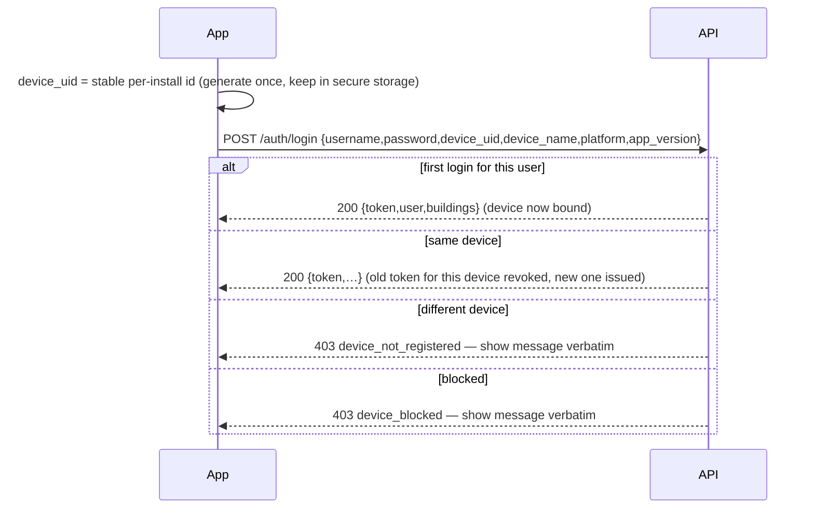
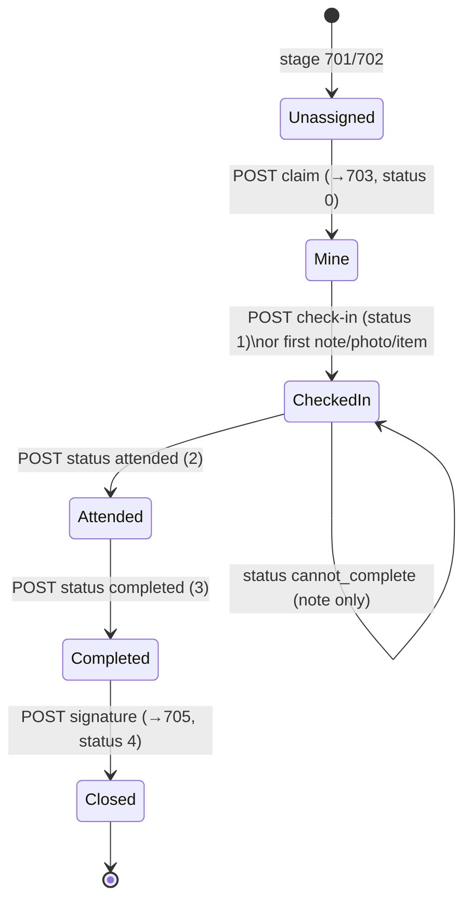
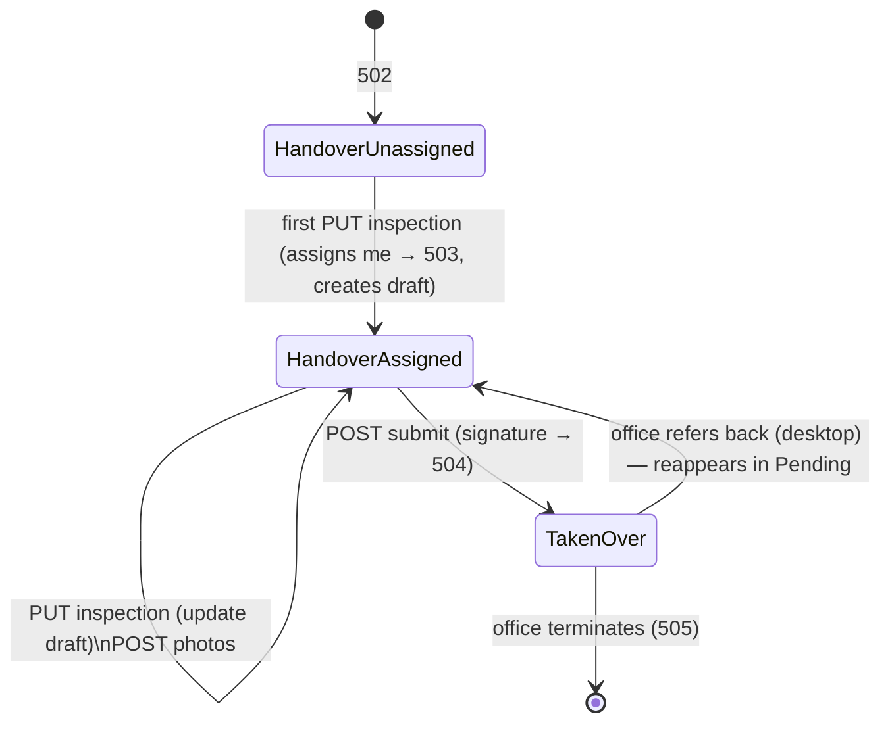
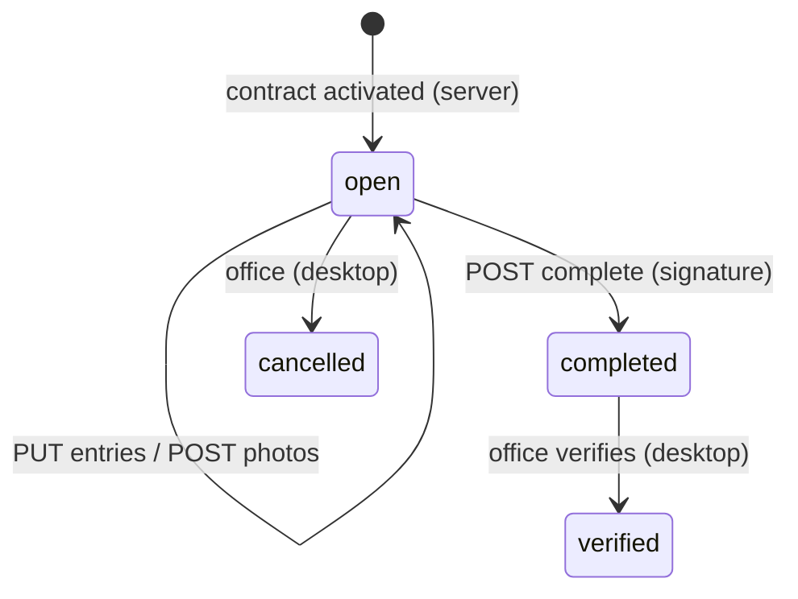

# PLMS ARE Mobile App — Workflow & Integration Guide

Companion to **[api-reference.md](api-reference.md)** (every field and example), **[openapi.json](openapi.json)** and the **[Postman collection](plms-mobile.postman_collection.json)**. This document is the *how*: screens, state machines, what the app must enforce locally, offline behaviour, and Flutter integration notes.

Audience: the Flutter developer building the ARE app. Stack assumed: Flutter 3.x, `dio`, `flutter_secure_storage`, `drift` or `sqflite` for the local cache, `signature` for the signature pad, `image_picker` + `flutter_image_compress`.

---

## 1. Who uses it and what it does

The **ARE** (Assistant Real-estate Executive) is the field person for a set of buildings. Three jobs, done at the unit on the phone:

| Job | API area | Ends with |
|---|---|---|
| Attend maintenance complaints like a technician | `/complaints` | tenant signature → ticket closed (705) |
| Perform the move-out (handover) inspection | `/terminations` | tenant signature → contract *Taken Over* (504) |
| Complete the move-in (onboarding) checklist | `/onboardings` | tenant signature → `completed`, back-office verifies |

Everything the ARE sees is limited to **their buildings for today** (server-enforced). If a building is reassigned to someone else, records disappear from lists and detail calls return `403 not_assigned` — treat that as "remove from local cache".

---

## 2. App skeleton

```
Splash ─► (no token) ─► Login ─► Home
       └► (token)    ─► GET /auth/me ─► Home
                          │ 401 → wipe → Login
                          │ 403 device_* → wipe → Login with the message
Home (buildings grid, counts) ─► Complaints | Inspections | Onboarding | Profile/Logout
```

**Home** = `GET /buildings`: one tile per building with `unassigned_complaints`, `my_complaints`, `pending_inspections`, `open_onboardings`. Tapping a tile opens the relevant list pre-filtered by `building_id`.

---

## 3. Login & the one-device rule



Rules the app must follow:

- `device_uid` must be **stable across app restarts** and unique per install. Generate a UUID on first launch and store it in `flutter_secure_storage`. Do **not** use the Android ID / IDFV directly (they change on reinstall/reset on some OS versions) — but if you want reinstalls to keep working, persist the UUID in the OS keychain/keystore which survives reinstall on iOS.
- Send `X-Device-Id` on **every** authenticated call. The server re-checks it each time; a mismatch is `403 device_not_registered` even with a valid token.
- Tokens never expire. Only `POST /auth/logout`, an admin *Clear*/*Block*, or a new login on the same device invalidate one. On **401** wipe the token and go to Login; on **403 device_\*** do the same and show `message`.
- Store `token`, `device_uid`, and the `user` object. Refresh `user` + `buildings` with `GET /auth/me` on each cold start (cheap).
- There is no OTP / password reset in v1 — the user asks the office.

---

## 4. Complaint attendance

### 4.1 Lists

| Tab | Query | Meaning | Actions |
|---|---|---|---|
| Unassigned | `tab=unassigned` | tickets in my buildings nobody has picked up (stage 701/702) | **Claim** |
| Mine | `tab=mine` | claimed by me, not yet attended (703, status 0/1) | Check-in, work |
| Attended | `tab=attended` | status 2 — waiting to be marked completed | Complete |
| Completed | `tab=completed` | status 3 (needs signature) or closed 705 | Sign / view PDF |

Show `priority` (1 = high), `complaint_date` age, `building.name`, `unit.no`, `tenant.name/mobile` (tap-to-call), `description`.

### 4.2 Ticket state machine (server-enforced)



- **Claim** is the only transition from *Unassigned*. Someone else (desktop coordinator or another ARE) may win the race → `409 invalid_state`: refresh the list.
- **Check-in** is idempotent and implicit: the first note/photo/item on a claimed ticket checks it in. Still call it explicitly on arrival with GPS so the timestamp/location is recorded.
- **Attended → Completed** can be done back-to-back on the same visit.
- **Close** needs status 3 **and** either a signature or `skipped:true` with at least one `after` photo. The app should disable the *Close* button until those hold, and still handle `409`.
- After close the ticket is read-only. Offer *Share PDF* via `GET …/service-report.pdf`.

### 4.3 Ticket screen (what to render from `GET /complaints/{ticket}`)

```
Header: ticket_no · complaint_no · priority · stage/status chip
Tenant: name · mobile (call) · unit · building
Description (checklist_desc) · work type
flags.tenant_status / complainer_category (badges)
previous_complaints[] (last 5 on this unit — context for the tech)
report (null until check-in):
  status chip · service_report_no
  Notes (timeline)  [+ Add note, quick reasons]
  Photos before/during/after  [+ Camera]
  Materials used  [+ Pick from /inventories, qty]  [swipe to delete]
  Signature preview once closed
Action bar by state: Claim | Check in | Attended | Completed | Close (signature)
```

`quick_reason` is a chip row above the note box: *Part required · Tenant not available · Access denied · Not our scope*. It only prefixes the note text server-side — no state change.

### 4.4 Signature capture

- Use a signature pad producing a **PNG data URL** (`data:image/png;base64,…`). Transparent background is fine; 600×300 px is plenty.
- Ask for `tenant_remark` on the same sheet (optional).
- "Tenant not available to sign" → `skipped: true`. The server insists on an `after` photo in that case.

---

## 5. Handover (termination) inspection

### 5.1 Lists

| Tab | Meaning | Action |
|---|---|---|
| Pending | 502 unassigned in my buildings, or 503 assigned to me with nothing saved yet, or referred back by the office | Start inspection |
| Inspected | draft saved by me, tenant not yet signed | Continue / Submit |
| Taken over | submitted by me (504) in the last 90 days | View PDF |

Show `overdue` (termination date passed) prominently — sort those first.

### 5.2 State machine



**Important id change:** the record the list gives you (say id 23753, stage 502) is *not* the row you finish on.

1. `GET /terminations/23753` → build the form from `template` (+ `draft` if any).
2. `PUT /terminations/23753/inspection` → response `data.stage = 503`, `data.draft.id = 23760`. **From now on use 23760** for photos, further saves and submit.
3. `POST /terminations/23760/submit` → response `data.id = 23761`, `data.stage = 504`. Use 23761 for `inspection.pdf`.

Keep a local map `listId → draftId → doneId` so the UI stays on one "case". Re-fetching the pending list after each step is the simplest way to stay consistent.

### 5.3 Inspection form

Built from `template[]`: one section per work (`code` is the label, e.g. *Carpenter*), each `sub_works[]` is a line the ARE can add with **quantity** and **amount** (OMR). Plus:

- *Other* lines: free text `other_work` + qty + amount.
- Utilities: electricity and water `acc_no`, `close_reading`, `amount` — each with a meter photo (`type=meter_electricity` / `meter_water`).
- `main_key_status` toggle (1 = key received) — photo `type=key`.
- `maintenance_due` (deducted), `notes` (required), `remark`.
- Show the server totals from `draft.totals` after each save; do not compute locally except as a live preview: `net = Σ lines + electricity.amount + water.amount − maintenance_due`.

Context panel from the detail: `outstanding_rent` (and `_this_contract`), `deposit_cheque`, `open_documents`, `previous_inspections` on the unit, and `refer_back.comment` when the office bounced it (show as a banner).

Send the **whole** checklist on every `PUT` — the server replaces the lines. Autosave on leaving the screen; the draft lives on the server, so a crashed phone loses at most the unsaved edits.

### 5.4 Submit

Signature pad (PNG data URL) + optional `tenant_remark` → `POST …/submit`. Show the PDF afterwards. `409` means the contract moved on (desktop advanced it, or it was already submitted): refresh.

---

## 6. Tenant onboarding (move-in checklist)

### 6.1 Lists

`tab=open` (to do) and `tab=completed` (done, includes office-verified). Rows appear automatically when a contract is activated; no "create" in the app.

### 6.2 State machine



### 6.3 Checklist screen

`items[]` from the detail, grouped by `group`. Render per `input_type`:

| `input_type` | Widget | `entry.value` |
|---|---|---|
| `check` | checkbox (+ N/A) | — |
| `text` | text field | text |
| `number` | numeric field | "12.5" |
| `count` | stepper | "3" |
| `photo` | camera only | — |
| `meter` | account no + reading (two fields) | "ACC 10234567 / 48213" (free format, one string) |

Every item has an optional `remark` and photos (`needs_photo` = show the camera prominently, not enforced server-side). Required items (`required: true`) must be `done` or `not_applicable` before *Complete* — the app should show `progress.done/total` and highlight missing required items; the server returns `409` with the list of missing titles if you try anyway.

Save entries incrementally (`PUT /entries` with only changed items — it upserts). Complete = signature + optional remark.

---

## 7. Photos, files and PDFs

- Compress before upload: max 1600 px on the long edge, JPEG ~80 % (the server re-encodes anyway, but this keeps uploads small on 3G). Hard limit 10 MB.
- Upload one photo per request (multipart field `photo`). Show a per-photo upload state; retry on failure.
- Every image/PDF URL in responses is a **signed URL valid 15 minutes**, no headers needed. Use it directly in `Image.network` / `CachedNetworkImage` with a cache key of the stable `path` query parameter (strip `expires`/`signature`), or download to the app's cache when first seen. Never persist the signed URL itself — re-fetch the record to get a fresh one.
- PDFs: `GET …/*.pdf` returns `{url}`; open with `url_launcher` / share via `share_plus` after downloading with `dio`.

---

## 8. Offline & sync strategy

The API is online-first; the server is the source of truth. Recommended level of offline support for v1:

| Capability | Approach |
|---|---|
| Read lists/details without network | Cache the last responses per tab in a local DB; show "last synced" time. Use `updated_since` (max `updated_at` you hold) with `per_page=100` to pull deltas on resume. |
| Compose while offline | Queue **notes**, **entries**, **inspection saves** (whole payload) and **photos** in an outbox table `{id, method, path, body|file, created_at, attempts}`. Replay in order when back online. |
| State-changing actions | *Claim*, *status*, *signature*, *submit*, *complete* — **online only**, disabled without network (they're short and the conflict rules matter). |
| Conflicts on replay | `409` → drop the queued item and re-fetch the record; `403 not_assigned`/`404` → drop the record locally; `422` → surface to the user. |
| Idempotency | Check-in, entries (upsert), inspection save (replace) are safe to replay. Notes/photos are *not* deduplicated server-side — mark an outbox row sent as soon as a 2xx arrives, and don't retry on ambiguous timeouts without re-reading the record first. |

Keep the outbox small and visible (a badge with pending count) so the ARE knows to get signal before leaving the building.

---

## 9. Flutter integration notes

### 9.1 HTTP client

```dart
final dio = Dio(BaseOptions(
  baseUrl: '$host/api/v1',
  headers: {'Accept': 'application/json'},
  connectTimeout: const Duration(seconds: 15),
  receiveTimeout: const Duration(seconds: 30),
));

dio.interceptors.add(InterceptorsWrapper(
  onRequest: (o, h) async {
    final token = await storage.read(key: 'token');
    final device = await storage.read(key: 'device_uid');
    if (token != null) o.headers['Authorization'] = 'Bearer $token';
    if (device != null) o.headers['X-Device-Id'] = device;
    o.headers['X-App-Version'] = appVersion;
    h.next(o);
  },
  onError: (e, h) async {
    final code = e.response?.data is Map ? e.response!.data['code'] : null;
    if (e.response?.statusCode == 401 ||
        code == 'device_not_registered' || code == 'device_blocked') {
      await session.signOut(message: e.response?.data['message']);
    }
    h.next(e);
  },
));
```

### 9.2 Error model

```dart
class ApiError implements Exception {
  final int status; final String code; final String message;
  final Map<String, List<String>> errors;
  static ApiError from(DioException e) {
    final d = e.response?.data;
    if (d is Map) {
      return ApiError(e.response!.statusCode!, d['code'] ?? 'unknown', d['message'] ?? '',
        (d['errors'] as Map?)?.map((k, v) => MapEntry(k, List<String>.from(v))) ?? {});
    }
    return ApiError(0, 'network', e.message ?? 'Network error', {});
  }
}
```
Map `code` to UX per the table in api-reference.md → *Error shape*.

### 9.3 Multipart upload

```dart
Future<void> uploadPhoto(int ticketId, File file, String stage) async {
  final compressed = await FlutterImageCompress.compressWithFile(file.path, minWidth: 1600, minHeight: 1600, quality: 80);
  final form = FormData.fromMap({
    'stage': stage,
    'photo': MultipartFile.fromBytes(compressed!, filename: 'photo.jpg', contentType: MediaType('image', 'jpeg')),
  });
  await dio.post('/complaints/$ticketId/photos', data: form);
}
```

### 9.4 Signature

```dart
final controller = SignatureController(penStrokeWidth: 3, exportBackgroundColor: Colors.transparent);
final bytes = await controller.toPngBytes(height: 300, width: 600);
final dataUrl = 'data:image/png;base64,${base64Encode(bytes!)}';
await dio.post('/complaints/$ticketId/signature', data: {'signature': dataUrl, 'tenant_remark': remark});
```

### 9.5 Device id

```dart
Future<String> deviceUid() async {
  var id = await storage.read(key: 'device_uid');
  if (id == null) { id = const Uuid().v4(); await storage.write(key: 'device_uid', value: id); }
  return id;
}
```
On iOS set `IOSOptions(accessibility: KeychainAccessibility.first_unlock)` so the id survives reinstall; on Android the keystore-backed storage is wiped on uninstall — a reinstall will need the office to *Clear* the device once (documented behaviour, not a bug).

### 9.6 Generating a client

`openapi.json` is OpenAPI 3.0.3 with full request schemas and real response examples:

```
openapi-generator-cli generate -i docs/mobile-app/openapi.json -g dart-dio -o mobile/api_client
```
Response bodies are typed as examples rather than strict schemas (they mirror Eloquent resources); generate models for requests and hand-write the few response DTOs you need, or use `json_serializable` from the examples.

---

## 10. Test environment

- Local server: `http://plms_backup.test` (Laragon) with `MOBILE_API_ENABLED=true`; from a phone on the same Wi-Fi use the machine's LAN IP and add it to Laragon's virtual host, or `php artisan serve --host 0.0.0.0`.
- Users: any user with role `are`/`are_team_lead` (they carry `mobile_app_login`). If a device gets bound to your test user during development, clear it under **PLM Module → Masters → Mobile Devices**.
- Postman: import `plms-mobile.postman_collection.json`, set `baseUrl`, `username`, `password`, run **Login** (stores the token), then set `ticketId` / `idId` from list responses.
- Test data: the `unassigned` complaints tab and `pending` handovers on the DB copy already have rows in the ARE buildings; onboardings are created for every newly activated contract and by `php artisan onboarding:sync --since="-30 days"`.

---

## 11. Out of scope for v1 (so the app doesn't wait for them)

OTP login, push notifications (poll `/buildings` counts on resume instead), Arabic, technician/landlord/tenant apps, editing closed records, creating complaints from the app, and a side-by-side move-in vs move-out comparison (the data supports it later).
